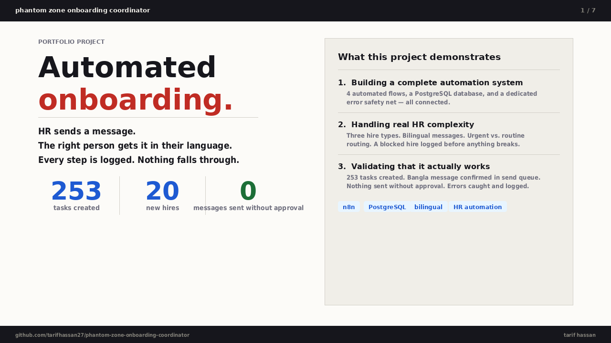
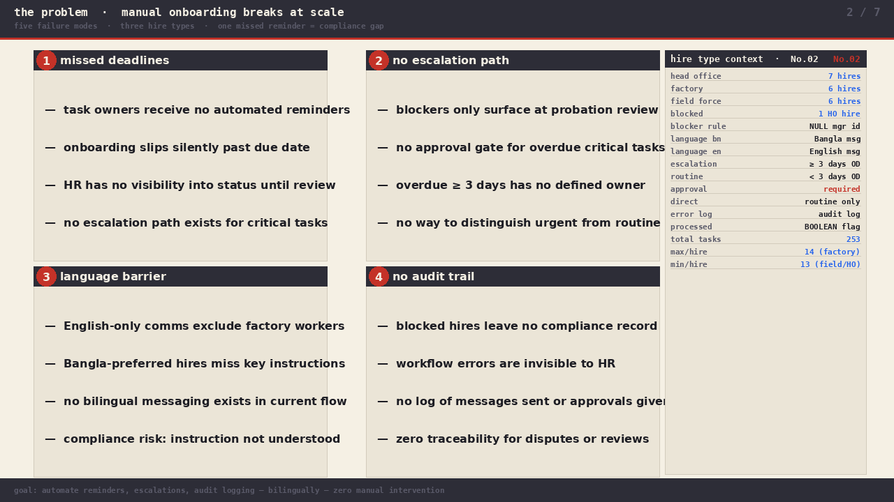
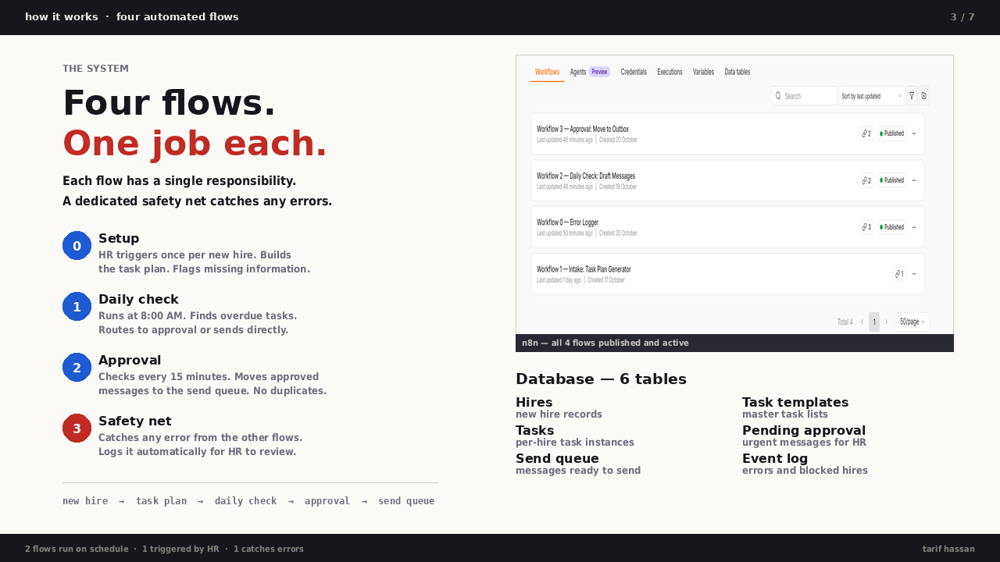
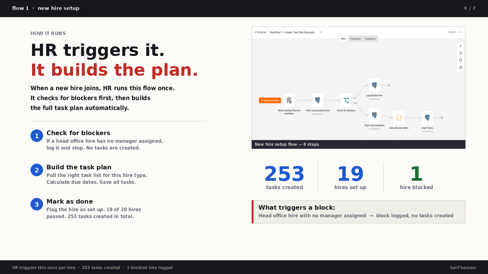
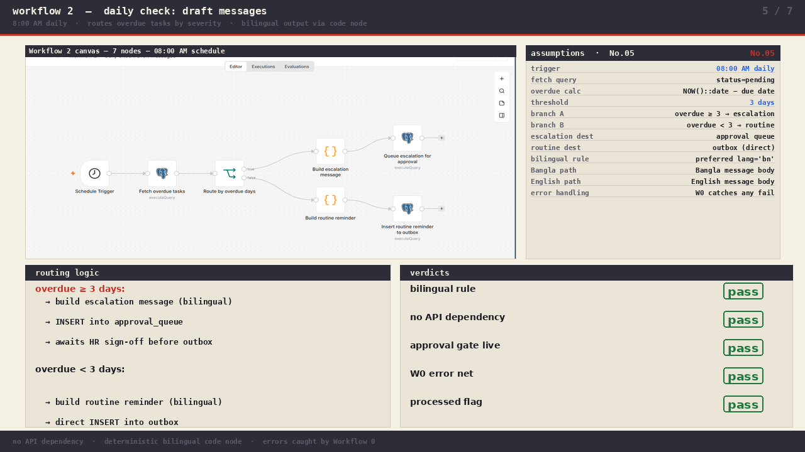
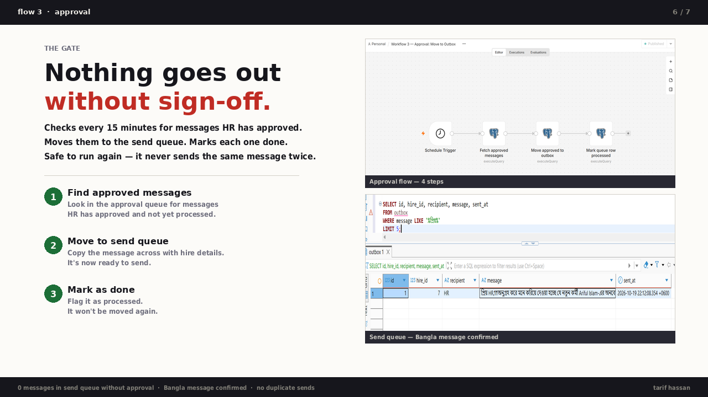
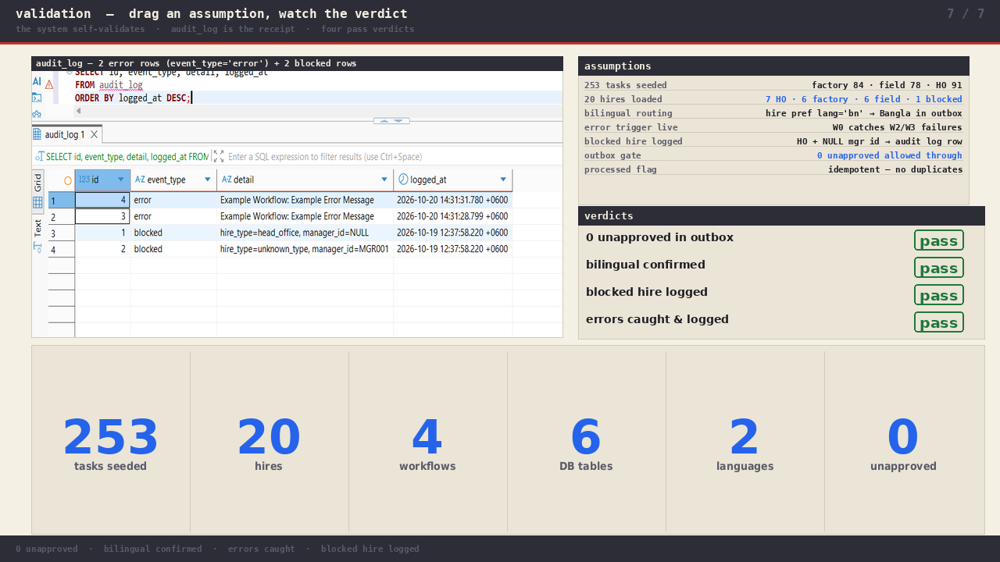

# Phantom Zone Onboarding Coordinator

A bilingual (Bangla/English) HR onboarding automation system built with n8n and PostgreSQL. Designed as a portfolio project for an AI Solutions Specialist – HR role application.

## What it does

Automates the onboarding task lifecycle for new hires across three hire types (head office, factory, field force):

- **Workflow 1 — Intake:** Generates a personalised task plan for each new hire based on hire type. Detects blockers (missing manager assignment for head office hires) and logs them before proceeding.
- **Workflow 2 — Daily Check:** Runs at 8:00 AM daily. Fetches all overdue pending tasks and routes them: escalations (3+ days overdue) go to an approval queue; routine reminders (under 3 days) go directly to the send queue. All messages are bilingual — Bangla or English based on the hire's language preference.
- **Workflow 3 — Approval:** Runs every 15 minutes. Moves approved escalations from the approval queue to the send queue and marks them processed.
- **Workflow 0 — Error Logger:** Catches failures from Workflows 2 and 3 and logs them to an audit trail.

## Stack

- **Automation:** n8n (self-hosted, v2.43.7)
- **Database:** PostgreSQL 18
- **Message generation:** Deterministic bilingual code nodes (no external API dependency)

## Database schema

| Table | Purpose |
|---|---|
| `hires` | New hire records with hire type and language preference |
| `task_templates` | Master task list per hire type |
| `tasks` | Per-hire task instances with due dates and status |
| `approval_queue` | Escalation messages pending HR approval |
| `outbox` | Messages cleared for sending |
| `audit_log` | Blocked hires and workflow errors |

## Repository structure

```
01_business_problem/   — problem statement, scenario suite, definitions
02_data/               — synthetic hire data, task templates
03_schema/             — DDL for all six tables
04_workflows/          — n8n workflow JSON exports
07_executive_brief/    — slide deck (PDF + PNGs)
```

## How to run

1. Import workflow JSONs into a self-hosted n8n instance
2. Create a PostgreSQL credential named `Postgres account`
3. Run the DDL in `03_schema/` against your database
4. Seed hires and task templates from `02_data/`
5. Execute Workflow 1 manually for each new hire
6. Workflows 2 and 3 run on schedule automatically

## Validation

- 253 tasks created across 20 new hires (7 head office, 6 factory, 6 field force, 1 blocked)
- 0 messages sent without approval
- Bilingual output confirmed for both Bangla and English preferences
- Error logging confirmed — blocked hire and workflow failures captured in audit trail

---

## Executive Brief

Full deck: [`07_executive_brief/phantom_zone_onboarding_brief.pdf`](07_executive_brief/phantom_zone_onboarding_brief.pdf)

### Slide 1 — Title



### Slide 2 — The Problem



### Slide 3 — System Architecture



### Slide 4 — Workflow 1: Intake



### Slide 5 — Workflow 2: Daily Check



### Slide 6 — Workflow 3: Approval & Outbox



### Slide 7 — Validation & Error Handling


