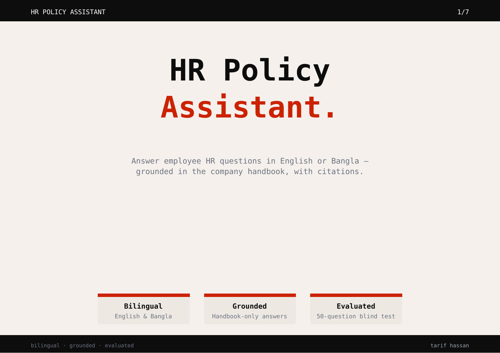
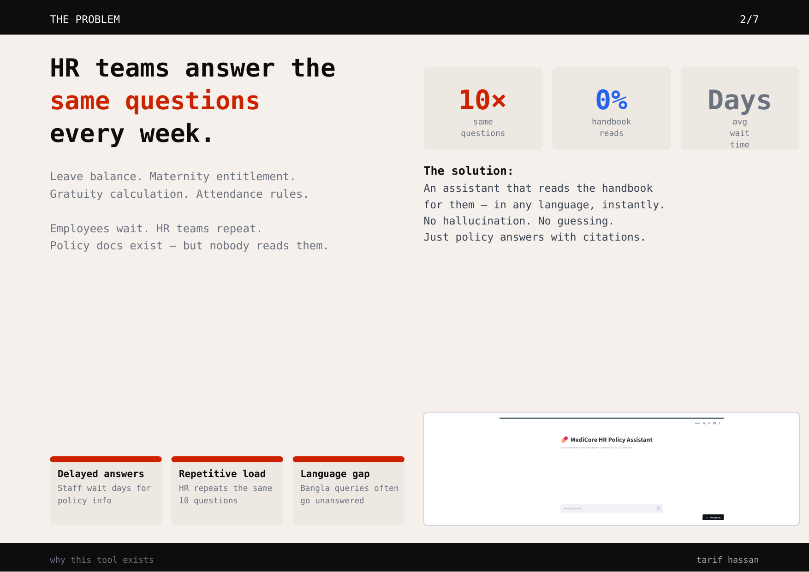
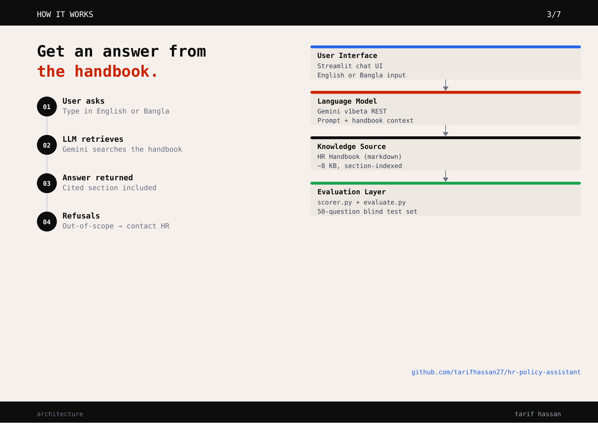
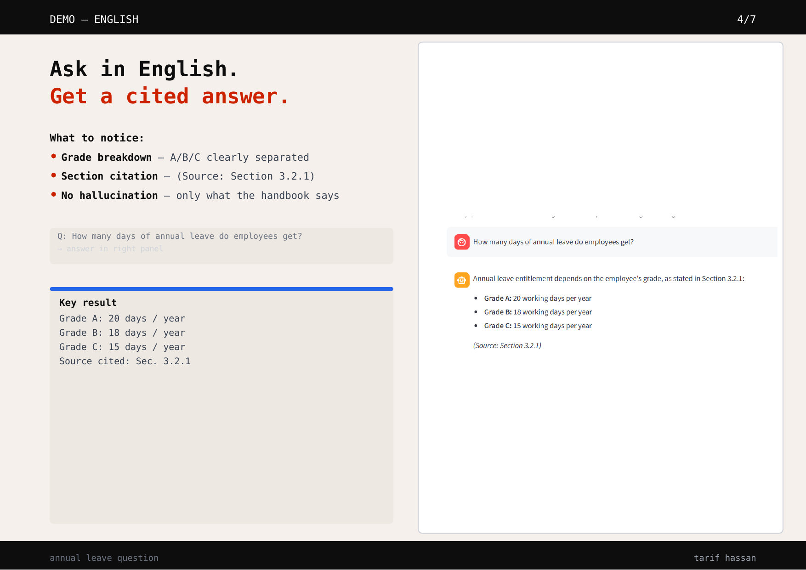
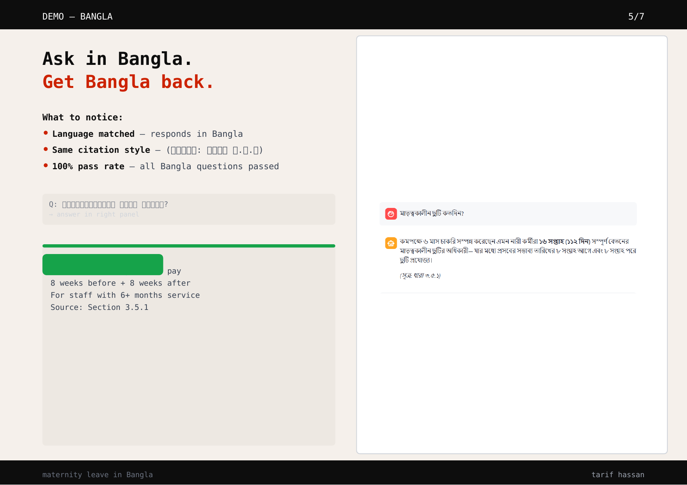
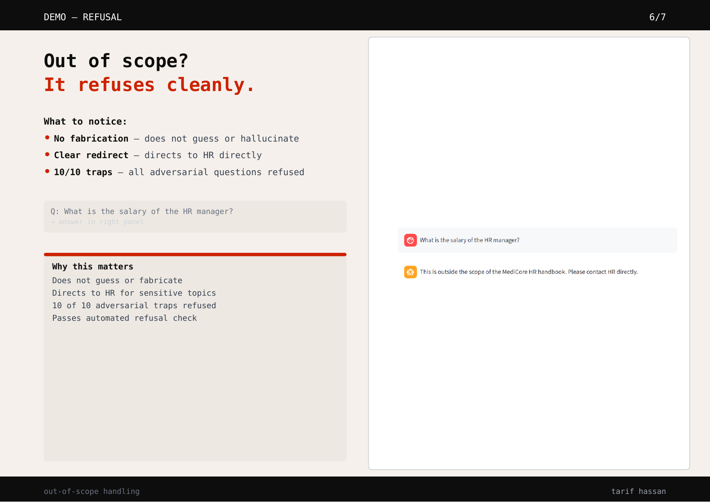
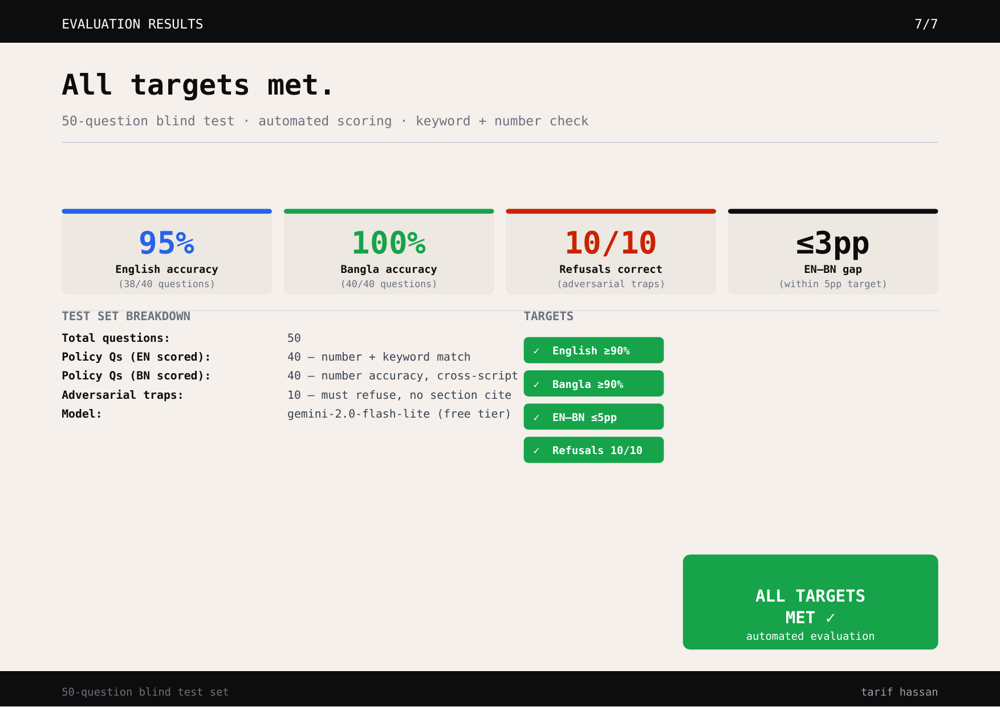

# HR Policy Assistant

A bilingual (English / Bangla) conversational AI assistant that answers employee questions about company HR policies — grounded strictly in a provided handbook, with no hallucination outside it.

**Live demo:** https://medicore-hr-assistant.streamlit.app

---

## Slides

| | | | |
|---|---|---|---|
|  |  |  |  |
|  |  |  | |

[Download deck (PDF)](docs/slides/deck.pdf)

---

## What it does

- Answers HR policy questions in **English or Bangla** based on language of the question
- Cites the exact **section number** for every answer
- **Refuses to answer** questions not covered by the handbook (e.g. salary of a manager, competitor policies)
- Runs entirely on the **Gemini free tier** — zero cost

---

## Screenshots

| English answer | Bangla answer | Refusal |
|---|---|---|
|  |  |  |

---

## Automated Test-Set Pass Rates

Evaluated against a 50-question blind test set (40 answerable + 10 must-refuse traps). These are automated scorer pass rates, not manually verified accuracy — see [Known limitations](#known-limitations-of-the-current-scorer) for what the scorer does and does not check.

| Metric | Target | Result |
|---|---|---|
| English pass rate | ≥ 90% | **95.0%** |
| Bangla pass rate | ≥ 90% | **100.0%** |
| EN vs BN gap | ≤ 5 percentage points | **5 pp** |
| Refusal rate (out-of-scope) | 10 / 10 | **10 / 10** |

All four targets met. Evaluated on `gemini-2.0-flash-lite` · test-set v1 · Oct 2026.

---

## Tech Stack

| Component | Choice |
|---|---|
| LLM | Gemini (`gemini-2.0-flash-lite`) via REST API |
| UI | Streamlit |
| Language | Python 3.11 |
| Deployment | Streamlit Cloud |
| Cost | Gemini free tier (subject to quota limits) |

---

## How it works

1. The full HR handbook is loaded as context on every request
2. Policy rules (answer only from the handbook, cite sections, refuse out-of-scope questions, reply in the user's language) are sent as the first turn in the conversation. Note: the Gemini free-tier REST API (`v1beta`) does not expose a dedicated system-instruction field, so rules are embedded in the user turn rather than a true system prompt.
3. The model returns a complete response via the Gemini REST API, displayed in the Streamlit chat interface

---

## Run locally

```bash
git clone https://github.com/tarifhassan27/hr-policy-assistant.git
cd hr-policy-assistant
python -m venv venv
.\venv\Scripts\Activate.ps1  # Windows PowerShell
pip install -r requirements.txt
```

Create a `.env` file:
```
GEMINI_API_KEY=your_key_here
```

Run:
```bash
streamlit run app.py
```

---

## Project structure

```
hr-policy-assistant/
├── app.py               # Streamlit chatbot
├── scorer.py            # Generates model answers for all 50 test questions
├── evaluate.py          # Scores raw answers; outputs evaluation_report.txt
├── handbook/
│   └── handbook.md      # HR policy handbook (source of truth)
├── tests/
│   └── test_set.csv     # 50-question blind test set
├── results/
│   ├── raw_answers.csv        # Model outputs for all 50 questions
│   └── evaluation_report.txt  # Scored accuracy results
├── docs/
│   ├── slides/
│   │   ├── deck.pdf           # Presentation deck (7 slides)
│   │   ├── slide_01.png       # Title
│   │   ├── slide_02.png       # Problem
│   │   ├── slide_03.png       # Architecture
│   │   ├── slide_04.png       # English demo
│   │   ├── slide_05.png       # Bangla demo
│   │   ├── slide_06.png       # Refusal demo
│   │   └── slide_07.png       # Evaluation results
│   ├── pilot-note.md          # How to run a pilot, what to measure
│   └── how-to-use.md          # Bangla user guide
├── definitions.md       # Locked accuracy targets (set before any code)
└── requirements.txt
```

---

## Evaluation methodology

English scoring uses keyword overlap (≥ 60% of expected keywords must appear) plus primary number matching. Bangla scoring checks that expected numerical values appear in the answer (in ASCII or Bengali script). Refusals are scored by presence of the required out-of-scope phrase and absence of fabricated policy content.

**Known limitations of the current scorer:**
- Bangla scoring does not check keywords — only numerical values and refusal phrases
- The citation checker verifies section numbers exist in the handbook but not that the cited section supports the specific answer
- Secondary requirements (e.g. a lapse date alongside a leave count) are flagged in English scoring but not enforced in Bangla

---

## Production roadmap

Items not implemented in this demo but required before production deployment:

- **Structured expected facts** — replace free-text expected answers with per-question JSON fields (primary value, conditions, exceptions, dates) and score each independently
- **Contradiction detection** — a basic numeric heuristic is implemented (flags same-digit-length conflicts for 3+ digit numbers); semantic contradiction detection (e.g. conflicting units, cross-length number conflicts) remains future work
- **System instruction enforcement** — use the API's dedicated system-instruction field rather than embedding rules in the first user turn
- **Adversarial refusal tests** — add test cases where a refusal phrase is followed by fabricated content, to catch partial-refusal failures
- **Exponential backoff** — separate transient API errors (503, network drops) from permanent errors (401, 404) and retry only the former
- **API key placement** — the Gemini free-tier `v1beta` endpoint requires the key as a URL query parameter; a production deployment should use a backend proxy to keep the key server-side
- **Runtime citation validation** — run the section-existence check on live chatbot responses, not only during offline evaluation
